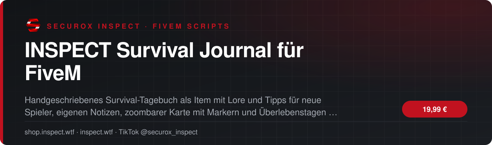
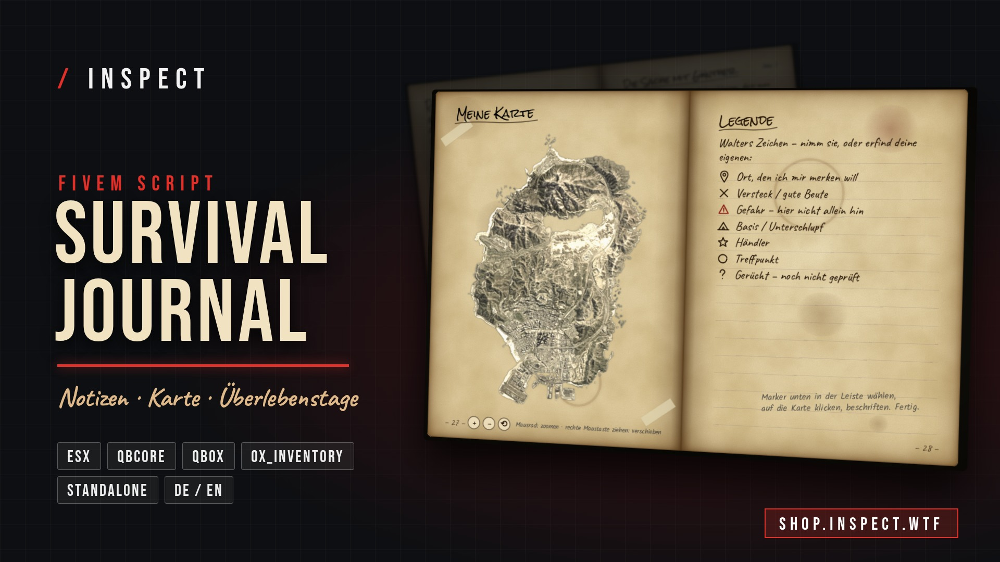

<!-- inspect-showcase: automatisch erzeugt, Änderungen bitte im Shop vornehmen -->

  
  
  
  
  

  
  
  

 

> 🇬🇧 **English:** INSPECT Survival Journal für FiveM – FiveM script (ESX, QBCore, Qbox) by SecuroX Inspect. Purchase and licensing exclusively at [shop.inspect.wtf](https://shop.inspect.wtf). Product details below are in German – questions are welcome on [Discord](https://discord.gg/inspect).

 

## Das Wichtigste auf einen Blick

<table>
  <tr>
    <td width="50%" valign="top">✔&nbsp; <b>Automatische Framework-Erkennung: ESX Legacy, QBCore, Qbox und Standalone</b></td>
    <td width="50%" valign="top">✔&nbsp; <b>Unterstützung für ox_inventory, qb-inventory, ESX-Standard und Framework-Items</b></td>
  </tr>
  <tr>
    <td width="50%" valign="top">✔&nbsp; <b>Echte Tagebuch-Optik mit Pergament, Handschrift, Kaffeeflecken und Skizzen</b></td>
    <td width="50%" valign="top">✔&nbsp; <b>3D-Seitenwechsel mit Blättergeräusch</b></td>
  </tr>
</table>

## Überblick

Das INSPECT Survival Journal ist ein immersives, handgeschriebenes Survival-Tagebuch für FiveM. Neue Spieler erhalten ein altes Tagebuch mit Server-Lore, Regeln und wichtigen Tipps für die ersten Schritte, dargestellt auf vergilbtem Pergament mit handschriftlicher Optik, Skizzen, Kaffeeflecken und 3D-Seitenwechseln mit Sound. Spieler können auf jeder Seite eigene Notizen schreiben und zeichnen, auf einer integrierten GTA-Karte eigene Orte markieren, Beschriftungen und Routen anlegen und ihre Überlebenstage als Strichliste verfolgen. Inhalte lassen sich vollständig über JSON-Dateien pflegen, ohne Code ändern zu müssen. Das Script erkennt ESX Legacy, QBCore, Qbox oder Standalone automatisch und unterstützt ox_inventory, qb-inventory, ESX-Standard sowie weitere Framework-Items. Alle persönlichen Inhalte werden pro Charakter in der Datenbank gespeichert.

## Kompatibilität

| | |
|:--|:--|
| Frameworks | **ESX** · **QBCore** · **Qbox** · **Standalone** |
| Unterstützte Ressourcen | `ox_inventory` |
| Plattform | FiveM (GTA V) |

## Alle weiteren Funktionen

- Alle Inhalte zentral über JSON-Dateien verwaltbar
- Seiten hinzufügen, umsortieren und formatieren ohne Codeänderung
- Automatisches Inhaltsverzeichnis und automatische Seitenzahlen
- Eigene Notizen auf jeder Seite mit frei platzierbaren Textfeldern
- Zeichenfunktion mit Stift, 6 Farben und 3 Größen
- Radierer- und Rückgängig-Funktion für Zeichnungen
- Zoombare GTA-Karte direkt im Tagebuch
- 7 Kartenmarker: Ort, Versteck, Gefahr, Basis, Händler, Treffpunkt und Gerücht
- Eigene Beschriftungen und Routen auf der Karte
- Automatische Überlebenstage-Strichliste pro Charakter

<b>14 weitere Funktionen anzeigen</b>

- Seitensprung über direkte Eingabe der Seitenzahl
- Eigenes Logo auf dem Einband möglich
- Eigenes Kartenbild möglich
- Deutsche und englische Beispieltexte enthalten
- Oberfläche auf Deutsch und Englisch
- Leseanimation mit Buch in der Hand
- Persistente Speicherung pro Charakter über oxmysql
- Datenbanktabellen werden automatisch angelegt
- Performante NUI: Oberfläche nur aktiv, während das Buch geöffnet ist
- Open Source und frei anpassbar
- Inventar-Icon enthalten
- Item-Einträge für ESX, ox_inventory und QBCore enthalten
- Ausführliche Anleitung auf Deutsch und Englisch enthalten
- Export für eigene Scripts: exports.inspect_journal:Open(source)

## Preis

**19,99 €** &nbsp;–&nbsp; einmaliger Kaufpreis · Download und Lizenz im Kundenkonto

Sichere Zahlung mit PayPal oder Kreditkarte · Rechnung als PDF · Support auf Deutsch

## So einfach geht's

1. **Im Shop kaufen** – sicher bezahlen mit PayPal oder Kreditkarte.
2. **Sofort loslegen** – Download und Lizenz stehen direkt nach Zahlungseingang in deinem Kundenkonto bereit, die Rechnung erhältst du als PDF.
3. **Einrichten** – bei Fragen hilft dir unser Support im Discord weiter.

## Warum INSPECT?

<table>
  <tr>
    <td width="50%" valign="top"><b>🇩🇪 Entwickelt in Deutschland</b> Konzeption, Entwicklung und Support aus einer Hand.</td>
    <td width="50%" valign="top"><b>💬 Persönlicher Support</b> Schnelle Hilfe auf Deutsch im INSPECT Discord.</td>
  </tr>
  <tr>
    <td width="50%" valign="top"><b>🔒 Sichere Zahlung</b> PayPal oder Kreditkarte, Rechnung automatisch als PDF.</td>
    <td width="50%" valign="top"><b>⚡ Sofort verfügbar</b> Download und Lizenz direkt nach der Zahlung im Kundenkonto.</td>
  </tr>
</table>

## Häufige Fragen

<b>Wie erhalte ich das Produkt?</b>

 

Nach bestätigter Zahlung stehen Download und Lizenz in deinem Kundenkonto bereit. Die Rechnung erhältst du als PDF.

<b>Welche Frameworks werden unterstützt?</b>

 

ESX, QBCore, Qbox, Standalone – zusätzlich mit Unterstützung für ox_inventory.

<b>Bekomme ich Hilfe bei der Einrichtung?</b>

 

Ja – unser Support hilft dir im [INSPECT Discord](https://discord.gg/inspect) persönlich und auf Deutsch.

<b>Wo kaufe ich offiziell?</b>

 

Ausschließlich im INSPECT Shop unter [shop.inspect.wtf](https://shop.inspect.wtf). Angebote von Dritten stammen nicht von uns.

## Kontakt

| | |
|:--|:--|
| 🛒 Shop | [shop.inspect.wtf](https://shop.inspect.wtf) |
| 🌐 Website | [inspect.wtf](https://inspect.wtf) |
| 💬 Discord | [discord.gg/inspect](https://discord.gg/inspect) |
| 🎬 TikTok | [@securox_inspect](https://www.tiktok.com/@securox_inspect) |
| ✉️ E-Mail | [info@inspect.wtf](mailto:info@inspect.wtf) |

---

<b>SecuroX Inspect</b> · Offizielle Produktpräsentation · Dieses Repository enthält keinen Quellcode und keine Produktdateien. 
Kauf und Lizenzen ausschließlich über <a href="https://shop.inspect.wtf">shop.inspect.wtf</a> · Inhalte werden automatisch aus dem Shop aktualisiert.

